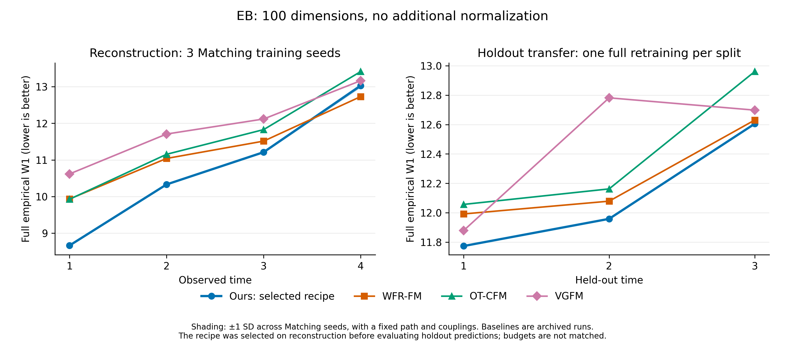

# EB tuning, 2026-10-23

This completed campaign selected a two-block, non-affine SiLU recipe at learning rate 0.001 for 60,000 Matching updates. Across three independent Matching initializations, reconstruction mean W1 is **10.808584 ± 0.020520** (sample SD), with mean mass error **0.5766%**. Three full-pipeline holdout retrainings give mean W1 **12.112162**, but mean holdout mass error remains **20.7479%**. The corresponding archived WFR-FM W1 values are 11.304492 and 12.233478. All 13 search configurations, two additional Matching retrainings, and three holdout retrainings completed. Earlier archived results remain unchanged.



## Data and evaluation

- `Code/data/eb_noscale.csv`: 100 coordinates, no additional coordinate normalization.
- Times 0–4 contain 2,381 / 4,163 / 3,278 / 3,665 / 3,332 cells.
- Primary task: full-data reconstruction. Selection uses mean empirical W1 over times 1–4, with raw mass error reported separately.
- Evaluation starts from every initial cell and follows one continuous weighted SDE. W1 uses every generated and observed cell, with probability normalization only for shape comparison.
- Fixed problem parameters: sigma 0.5, alpha 1225, quadratic-minimal compatible controls, renormalized surrogate.
- Matching candidates start from random initialization, share a newly trained conditional path, and use 30,000 or 60,000 updates. Initial training seed 42; common evaluation seeds 342 and 343.
- The original trained models were not present in the cloned repository or the checked GPU workspace. New results are reruns, not edits or reevaluations of the historical checkpoints.

## Baselines already present in this setting

All six methods have EB full-data reconstruction results and all three internal-time holdout results in the committed CSVs. Holdout baselines use training seed 42. VarRUOT was explicitly skipped in the archived baseline-stage record; no original DeepRUOT comparison appears in these tables.

| Method | Reconstruction mean W1 | Mean mass relative error | Hold t=1 W1 | Hold t=2 W1 | Hold t=3 W1 |
|---|---:|---:|---:|---:|---:|
| WFR-FM | 11.304492 | 0.006575 | 11.991458 | 12.078430 | 12.630547 |
| OT-CFM | 11.580457 | 0.334364 | 12.056269 | 12.162030 | 12.960829 |
| VGFM | 11.901866 | 0.059983 | 11.877882 | 12.781936 | 12.698158 |
| USB | 12.732181 | 0.017928 | 12.379539 | 13.155500 | 13.818844 |
| wl-mechanics UBOT | 13.981791 | unavailable | 13.469803 | 14.485213 | 14.827041 |
| S2FM | 14.350330 | 0.334364 | 12.235989 | 13.632266 | 15.626211 |

Sources: `method_dataset_summary.csv`, `../Experiment3/baseline_holdout_w1.csv`, and `../Experiment3/baseline_stage.json`. These are archived results, not new baseline runs.

The holdout CSV records different method-specific budgets: WFR-FM/OT-CFM 3,000 epochs and batch 512; USB 3,000 steps and batch 512; S2FM 1,000 epochs and batch 1,024; VGFM 500 pretraining and 100 finetuning epochs; wl-mechanics 10,000 iterations. They should not be described as equal-compute comparisons. WFR-FM/OT-CFM are deterministic baselines; USB/S2FM record sigma 0.5. The reconstruction table does not include the detailed training budgets.

## Initial search

The conditional path follows `experiment3_eb_noscale_base.yaml`: 64×3 network, 1,500 updates, 4,096 conditions per batch, 8 time samples per condition. This configuration retains all five times when used for reconstruction.

The existing coupling partitions each snapshot into eight consecutive blocks. A second candidate uses two blocks to increase the available endpoint support without changing the problem or the learned conditional path. Both must satisfy the existing coupling convergence criteria.

Matching candidates compare the affine SiLU reference at learning rate 0.003 with non-affine SiLU and LeakyReLU at 0.001. Each uses four independent 512×8 networks, batch 2,048, and cosine decay to 0.00001. The same recipes are compared on both coupling supports.

Reconstruction is the tuning task. Any later holdout evaluation of a configuration selected here is an exploratory transfer comparison, not an untouched test set for hyperparameter selection.

## Coupling support diagnostic

Mean source-to-nearest-target distance under each allowed support:

| Interval | Eight blocks | Two blocks | Unrestricted |
|---|---:|---:|---:|
| 0 to 1 | 11.8642 | 11.0645 | 10.8154 |
| 1 to 2 | 13.0595 | 12.3823 | 12.0829 |
| 2 to 3 | 12.7484 | 12.0203 | 11.7089 |
| 3 to 4 | 14.5062 | 13.6323 | 13.2577 |

This is a geometric diagnostic, not an optimized coupling or a model evaluation. Two blocks offer closer candidate connections in every interval. Whether this improves the learned feedback is measured by the training comparisons.

## Completed reconstruction search

All 13 configurations below completed training and both full SDE evaluations. Values average over times 1–4 and rollout seeds 342 and 343, with Matching training seed 42. These two rollout seeds do not measure independent-training variability.

| Network | Blocks per interval | Initial learning rate | Matching updates | Mean W1 | Mean mass error |
|---|---:|---:|---:|---:|---:|
| Non-affine SiLU | 2 | 0.001 | 60,000 | **10.815285** | 0.6962% |
| Non-affine SiLU | 8 | 0.001 | 60,000 | 10.924744 | 0.7151% |
| Non-affine SiLU | 2 | 0.001 | 30,000 | 11.023118 | 0.5238% |
| Non-affine SiLU | 8 | 0.001 | 30,000 | 11.167336 | 0.4649% |
| Affine SiLU | 8 | 0.001 | 30,000 | 11.202574 | 0.5300% |
| Non-affine SiLU | 8 | 0.0003 | 30,000 | 11.817213 | 0.6566% |
| Non-affine LeakyReLU | 2 | 0.001 | 30,000 | 12.724890 | 0.6992% |
| Non-affine LeakyReLU | 8 | 0.001 | 30,000 | 12.867554 | 0.8738% |
| Non-affine LeakyReLU | 2 | 0.003 | 30,000 | 13.153347 | 0.7880% |
| Non-affine LeakyReLU | 8 | 0.003 | 30,000 | 13.295190 | 0.6993% |
| Affine SiLU | 2 | 0.003 | 30,000 | 13.445959 | 0.4959% |
| Affine SiLU | 8 | 0.003 | 30,000 | 13.606986 | 0.5120% |
| Non-affine SiLU | 8 | 0.003 | 30,000 | 13.656062 | 0.6455% |

The selected configuration is `Code/configs/eb_noscale_tuned_20261023.yaml`: four independent 512×8 non-affine output-LayerNorm SiLU networks, batch 2,048, learning rate 0.001 with cosine decay to 0.00001, 60,000 Matching updates, and two coupling blocks per interval. Sigma 0.5, alpha 1225, the conditional-path objective, and the Matching objective are unchanged. Every candidate starts Matching from random initialization; 60,000-step candidates use a 60,000-step cosine schedule from the start, rather than resuming a finished 30,000-step schedule.

The configuration was frozen at 2026-10-23 00:55:32 UTC+8 after all 13 reconstruction evaluations and before any holdout prediction results. `selection.json` records the selection. Additional training seeds and holdout results evaluate this fixed configuration.

The controlled comparisons support the following observations:

- For SiLU, learning rate 0.003 is substantially worse than 0.001. At 0.001, affine and non-affine LayerNorm are close (11.202574 versus 11.167336); the large improvement cannot be attributed mainly to removing affine parameters.
- At the tested rates, SiLU performs better than LeakyReLU. The original base combination of non-affine LeakyReLU and 0.003 was rerun explicitly.
- Expanding coupling support from eight to two blocks gives a smaller, consistent improvement in the matched comparisons. At 60,000 steps, it lowers SiLU W1 from 10.924744 to 10.815285.
- Extending the selected two-block recipe from 30,000 to 60,000 updates lowers W1 from 11.023118 to 10.815285, while mean mass error rises from 0.5238% to 0.6962%.

For the selected seed-42 model, W1 at times 1–4 is 8.665231 / 10.330975 / 11.218534 / 13.046400. Its mean W1 is 4.33% below the archived WFR-FM result, but terminal W1 remains above WFR-FM's 12.730449. This is not uniform superiority over all times and metrics. The baseline numbers come from archived runs, not matched-budget retraining in this campaign.

Conditional-path training completed all 1,500 updates in 45.5 seconds. All coupling blocks converged with the original tolerances. Coupling wall time was 437.1 seconds for eight blocks per interval and 770.6 seconds for two blocks per interval on this host. These timings include shared cost-table queries and do not establish an overall speed advantage over baselines.

## Independent Matching repeats and holdout transfer

Matching seeds 43 and 44 completed training with the frozen recipe and the same conditional path and couplings as seed 42. Each was evaluated with rollout seeds 342 and 343. This assesses Matching-training variability, not variation of independently retrained full pipelines.

| Matching training seed | Mean W1 | Mean mass error |
|---|---:|---:|
| 42 | 10.815285 | 0.6962% |
| 43 | 10.824915 | 0.4109% |
| 44 | 10.785551 | 0.6225% |
| Mean across training seeds | **10.808584** | **0.5766%** |

The sample SD of the three per-training-seed W1 means is 0.020520. All six complete SDE rollouts succeeded. The average W1 is 4.3868% below the archived WFR-FM result. These are three Matching retrainings with shared path/couplings, and the baseline was not independently retrained here; this is not a matched-budget statistical superiority test.

The three holdout jobs completed retraining the conditional path, couplings, and Matching from scratch on their retained snapshots. The withheld snapshot was removed from each training CSV, retained times were compressed to consecutive integers, and predictions used the midpoint of the gap, matching the archived protocol. Every split used training seed 42 and rollout seed 342. The recipe was selected using full-data reconstruction, so this is an exploratory transfer comparison rather than an untouched hyperparameter-selection test set.

| Method | Hold t=1 W1 | Hold t=2 W1 | Hold t=3 W1 | Mean W1 |
|---|---:|---:|---:|---:|
| Ours, selected recipe | **11.772956** | **11.958179** | **12.605351** | **12.112162** |
| WFR-FM, archived | 11.991458 | 12.078430 | 12.630547 | 12.233478 |
| OT-CFM, archived | 12.056269 | 12.162030 | 12.960829 | 12.393043 |
| VGFM, archived | 11.877882 | 12.781936 | 12.698158 | 12.452659 |
| USB, archived | 12.379539 | 13.155500 | 13.818844 | 13.117961 |
| S2FM, archived | 12.235989 | 13.632266 | 15.626211 | 13.831489 |
| wl-mechanics UBOT, archived | 13.469803 | 14.485213 | 14.827041 | 14.260685 |
| Ours, archived affine SiLU | 12.308435 | 13.303769 | 14.875226 | 13.495810 |

The selected recipe improves mean holdout W1 by about 10.3% relative to the archived affine-SiLU run and 1.0% relative to archived WFR-FM. It is numerically lowest at all three held-out times in these runs. The margins over the strongest baseline at each individual time are small, particularly 0.025196 at t=3; with one full retraining per split and unequal method budgets, this does not establish statistically reliable or equal-compute superiority.

Holdout mass prediction is still poor:

| Held-out time | Predicted mass / initial mass | Observed mass / initial mass | Relative mass error |
|---|---:|---:|---:|
| 1 | 1.151336 | 1.748425 | 34.1501% |
| 2 | 1.624122 | 1.376732 | 17.9693% |
| 3 | 1.383427 | 1.539269 | 10.1244% |

For context, simply interpolating the cell counts of the two retained neighbors would already incur 32.0322%, 19.4021%, and 9.8226% mass errors. This arithmetic diagnostic is not an additional trained baseline. The selected model also smooths over the unseen mass peaks and troughs; the low reconstruction mass error does not demonstrate accurate holdout mass prediction. The archived holdout table does not report baseline mass errors, so no comparative mass-superiority claim is supported there.

All three holdout SDE rollouts completed with finite states and weights. Effective sample sizes were close to all 2,381 initial particles, so the large mass errors are not evidence of particle-weight collapse. The experiments support improved spatial fit under this protocol while leaving holdout mass prediction unresolved.

## Artifacts and reproduction

- `Doc/Experiment2/eb_tuning_20261023_results.csv`: all 13 configurations and per-time W1.
- `Doc/Experiment2/eb_tuning_20261023_seed_metrics.csv`: all timepoints for three Matching training seeds and two rollout seeds each.
- `Doc/Experiment2/eb_tuning_20261023_holdout.csv`: the three new full-pipeline holdout results, including raw mass errors and completion status.
- `Doc/Experiment2/Figures/eb_tuning_20261023.{png,pdf}` and `Code/scripts/plot_eb_tuning_20261023.py`: figure and reproducible plotting code.
- `Code/configs/eb_noscale_tuned_20261023.yaml`: selected complete recipe.
- `Code/scripts/run_eb_tuning.py`: common-path coupling and fresh Matching comparisons.
- `Code/scripts/launch_eb_tuning_20261023.py`: initial six-candidate schedule.
- `Code/scripts/run_experiment3_ours.py --base-config ...`: transfer a selected recipe to freshly trained holdout models; also records raw mass error.
- Local audit data: `Results/eb_tuning_20261023/` (ignored by Git).
- Remote runs, checkpoints, couplings and logs: `msfm:/data/ubuntu-home/jianzheli/icml/Co-Creation-Research-1/Results/eb_tuning_20261023/`.

Execution used Python 3.10.12, PyTorch 2.11.0+cu128, POT 0.9.7.post1, and RTX 4090 D GPUs in an existing environment. `Results/eb_tuning_20261023/completion.json` records the completed campaign. Conditional-path and coupling files remain shared only where declared; no old feedback weights were used to initialize the new reconstruction or holdout Matching models.

From the `Code/` directory, the selected complete reconstruction pipeline can be run in a new directory with:

```sh
python -m src.cli --config configs/eb_noscale_tuned_20261023.yaml --run-dir ../Results/eb_selected_rerun --stage pairs
python -m src.cli --config configs/eb_noscale_tuned_20261023.yaml --run-dir ../Results/eb_selected_rerun --stage couplings
python -m src.cli --config configs/eb_noscale_tuned_20261023.yaml --run-dir ../Results/eb_selected_rerun --stage matching
python scripts/evaluate_one_run_w1_seeds.py --run-dir ../Results/eb_selected_rerun --seeds 342 343
```

The three holdout splits can be rerun sequentially, with all stages freshly trained for each split, using:

```sh
python scripts/run_experiment3_ours.py --dataset eb_noscale --base-config configs/eb_noscale_tuned_20261023.yaml --output-root ../Results/eb_selected_holdout_rerun
```
